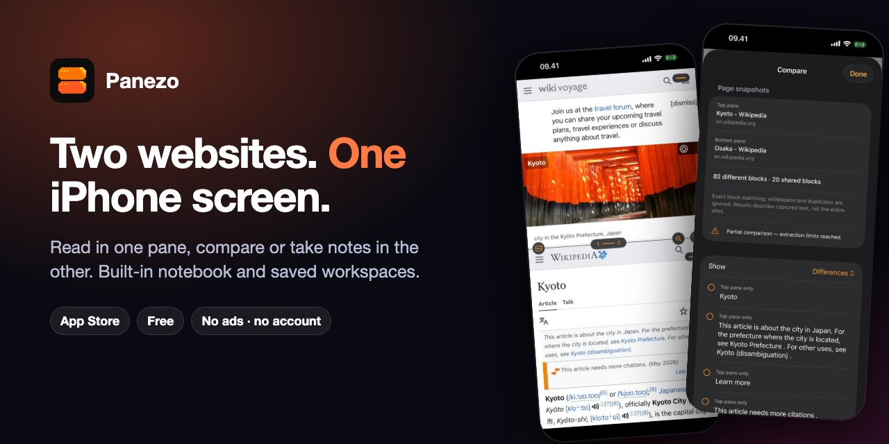
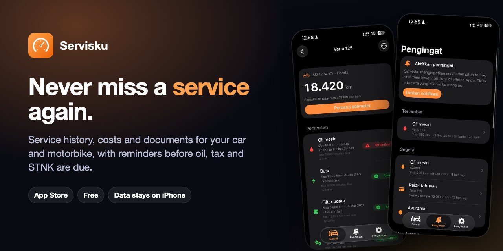
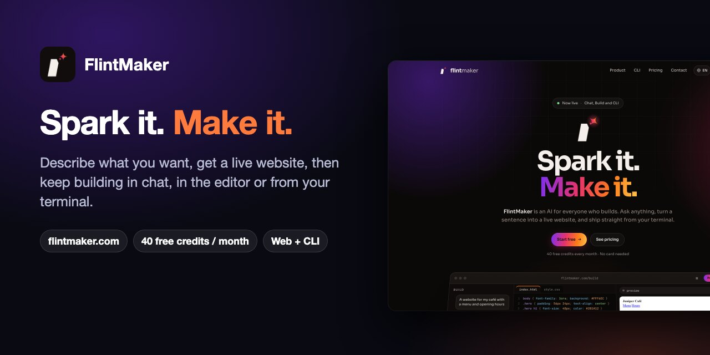

## Hi, I'm Ilyas Akbar Almadani

Founder of [PT Jiji Labs Digital](https://jijilabsdigital.com). I lead product and design for calm, private apps on Mac, iPhone and the web: no ads, no tracking, and your data stays on your device.

### ⭐ New on the Mac App Store: SHIPSAFE

**Catch leaked API keys, debug leftovers and unprotected routes before you ship.** SHIPSAFE scans your project locally on your Mac and gives you a release-readiness score, with the file, the line and the fix for every finding.

- 148 release checks: secrets, debug config, admin routes, dependencies, destructive migrations
- Reads Swift, plist, xcconfig, JSON, YAML and every other text file
- No account, no upload, no AI calls. Your code never leaves your Mac
- $9.99 once. No subscription

[Mac App Store](https://apps.apple.com/us/app/shipsafe-release-readiness/id6808833747?mt=12) · [Demo & screenshots](https://github.com/ilyasaalmadani/shipsafe-macos) · [Free pre-release checklist for iOS/Mac devs](https://github.com/ilyasaalmadani/shipsafe-macos/blob/main/RELEASE-CHECKLIST.md)

### Also live

**Panezo** · iPhone · Free. Two websites side by side on one screen, with a notebook built in. Compare products, hotels or recipes, read in one pane and take notes in the other. No account, no ads, no analytics.
[App Store](https://apps.apple.com/app/panezo/id6815559754) · [Website](https://ilyasaalmadani.github.io/panezo-site/)

**Servisku** · iPhone · Free. Service history, costs and documents for your car and motorbike, with reminders before oil, tax, STNK and licence are due. Data stays on your iPhone.
[App Store (Indonesia)](https://apps.apple.com/id/app/id6818012170)

**FlintMaker** · Web & CLI. Describe what you want and get a live website, then keep building in chat, in the editor or from your terminal. 40 free credits every month, no card needed.
[flintmaker.com](https://flintmaker.com) · [flint CLI on GitHub](https://github.com/ilyasaalmadani/flintmaker-cli) · `npm i -g flintmaker`

More apps are on their way. See the full lineup at [jijilabsdigital.com](https://jijilabsdigital.com).

### How I work

- **Privacy first.** No third-party tracking SDKs. System frameworks wherever possible.
- **Evidence over claims.** Every build goes through source guards, automated tests and on-device checks before release.
- **Never lose user data.** Updates are in-place, and destructive actions always ask first.

### Stack

Swift · SwiftUI · UIKit · WebKit · XCTest · Xcode · Node.js · Cloudflare Workers

### Contact

📫 [hello@jijilabsdigital.com](mailto:hello@jijilabsdigital.com) · Support: [support@jijilabsdigital.com](mailto:support@jijilabsdigital.com)

Ilyas A. Almadani · PT Jiji Labs Digital
